# questiongame

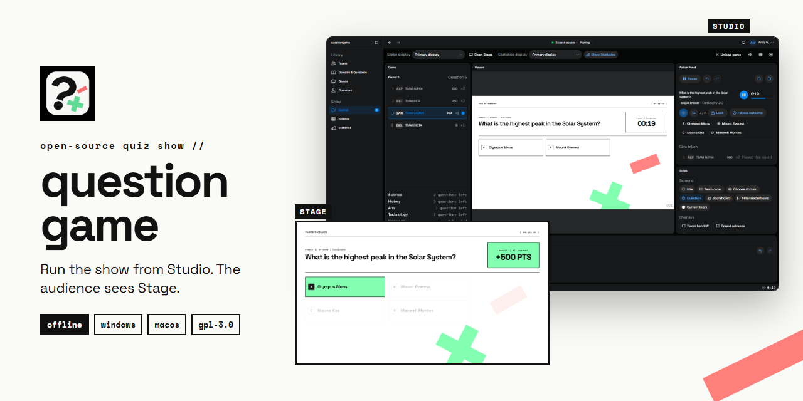

**A quiz show you run from one computer.** An operator drives the game from
**Studio**; the teams, the audience and the camera see only **Stage**, a
fullscreen screen on a TV, a projector, or a second monitor.

It works completely offline, on Windows and macOS, and it is free and open
source. It is made for recorded shows, but works just as well for a classroom
or a quiz night with friends.

---

## Download and install

Get the latest version from the
**[Releases page](https://github.com/aAndy03/question-game/releases/latest)**.

| Your computer | Download |
| --- | --- |
| Windows 10 or 11 | `questiongame_…_x64-setup.exe` |
| macOS 13 or later (Apple Silicon or Intel) | `questiongame_…_universal.dmg` |

> [!WARNING]
> **The installers are not signed.** questiongame is a free project and does
> not pay for code-signing certificates, so your computer will warn you the
> first time you install it. This is expected. The steps below get you past
> the warning.

### Windows

1. Double-click the downloaded `questiongame_…_x64-setup.exe`.
2. A blue **"Windows protected your PC"** screen (Microsoft Defender
   SmartScreen) appears. Click **More info**, then **Run anyway**.
3. Follow the installer. It installs for your user account only and does not
   ask for administrator rights.
4. Start **questiongame** from the Start menu.

### macOS

1. Open the downloaded `.dmg` and drag **questiongame** into **Applications**.
2. Open questiongame from Applications. macOS says it cannot verify the
   developer; click **Done** (or **Cancel**).
3. Open **System Settings → Privacy & Security**, scroll down, and click
   **Open Anyway** next to questiongame. Confirm once more.
4. From then on, questiongame opens normally.

---

## Your first show

1. **First run** asks for an operator name and offers to load the **Demo**
   game (in English, and a Romanian one). Load it: it is the fastest way to
   see everything work.
2. Open **Games**, pick the Demo, and press **Load into Control**. Stage opens
   fullscreen. With a second screen connected, use **Stage display** at the
   top of Control to send Stage there; questiongame remembers it.
3. In **Control**, press **Start Play**. Choose a domain (or press `1`–`9`),
   reveal the question and the answers, then **Lock** (`Enter`) and **Reveal
   outcome** (`R`). `Space` starts and pauses the timer; `Ctrl+Z` undoes a
   turn.
4. When every question is used, the Play ends and **Reveal next place** walks
   the final leaderboard from last place to first.

Build your own game in the tabs on the left: **Teams**, **Domains &
Questions** (questions can also be imported from a JSON file), **Games** for
the roster, board and scoring rules, and **Screens** to restyle Stage and
change its wording.

One screen is enough: Stage goes fullscreen and Studio is an `Alt+Tab` (or
`Cmd+Tab`) away.

### Good to know

- **Your work is saved as you go.** Every answer is written to disk the moment
  it happens. If the app is closed mid-show, the Play resumes where it
  stopped.
- **Closing Studio asks first** when a game is loaded or an editor has unsaved
  changes. Pressing close a second time quits regardless.
- **Where your data lives:** Windows `%APPDATA%\org.questiongame.desktop`,
  macOS `~/Library/Application Support/org.questiongame.desktop`. Settings ▸
  Data shows the exact folder and can open it.

### Updating

questiongame does not update itself. When a newer release is out, Studio says
so once when it starts (never during a game), and Settings ▸ About has
**Check for updates**. Both open the release page.

**Install the new version over the one you have — do not uninstall first.**
Run the new installer (Windows) or drag the new app over the old one in
Applications (macOS). Your library stays where it is, and the new version
copies it to `backups/` in the data folder before it changes anything — the
five newest copies are kept. Uninstalling first risks ticking *Delete the
application data*, which removes your library.

Checking for updates is the only time questiongame uses the network: one
request to GitHub's public API, from the app itself. Turn it off in Settings ▸
About (*Check for updates when questiongame starts*); everything else works
the same offline.

### Uninstalling

- **Remove the app, keep your library:** on Windows, Settings ▸ Data ▸
  **Uninstall…** inside questiongame (or Windows Settings ▸ Apps) opens the
  uninstaller; leave *Delete the application data* unticked. On macOS, drag
  questiongame from Applications to the Trash.
- **Remove the app and your library:** tick *Delete the application data* in
  the Windows uninstaller. On macOS, also delete the data folder above.
- **Remove only your library:** Settings ▸ Data ▸ **Remove generated data**.

### Something went wrong?

questiongame keeps a log next to your data (`questiongame.log`), and
Settings ▸ Data shows where. If the app refuses to start, it says why in a
message box. Please attach the log when you
[open an issue](https://github.com/aAndy03/question-game/issues).

---

## What it looks like

### Studio — where the operator runs the show

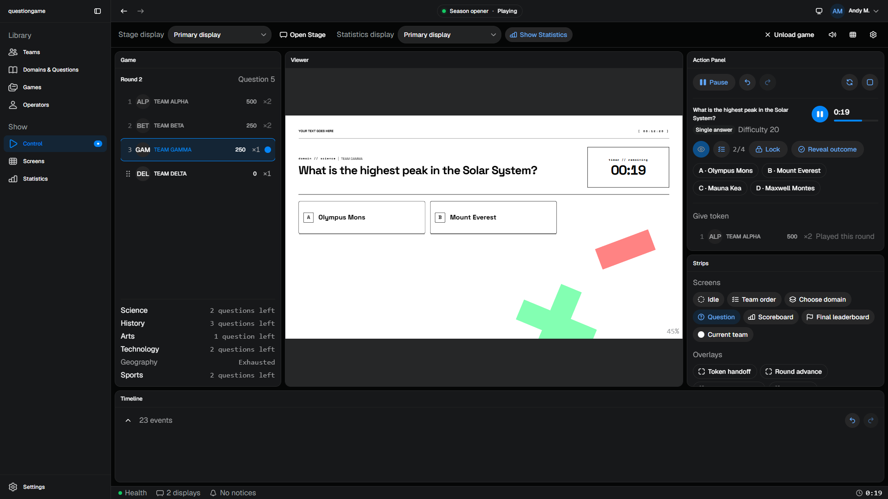
*Control: who holds the token, a live preview of Stage, and every action for the current question.*

| | |
| --- | --- |
| 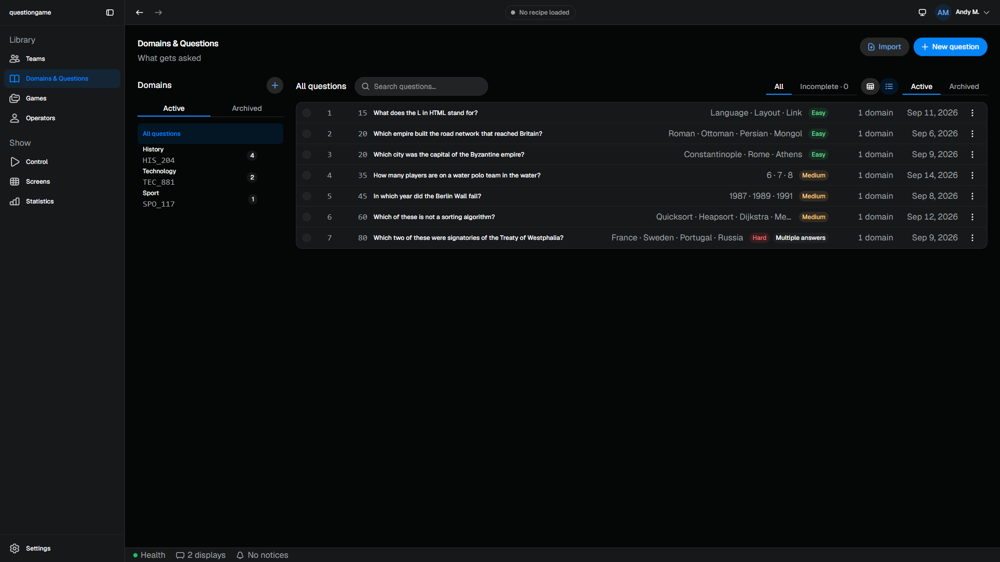 | 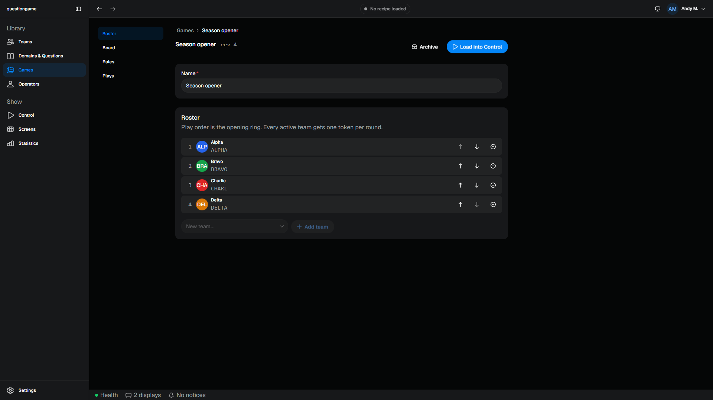 |
| **Domains & Questions** — the library, with difficulty and completeness at a glance. | **Games** — the roster, the board and the scoring rules of one show. |
| 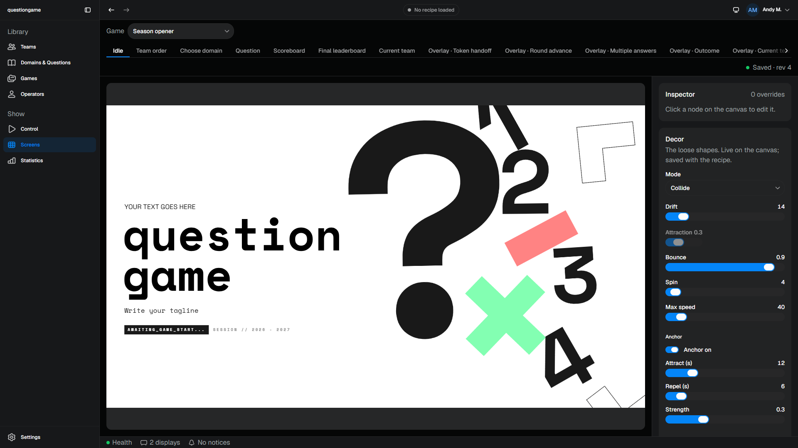 | 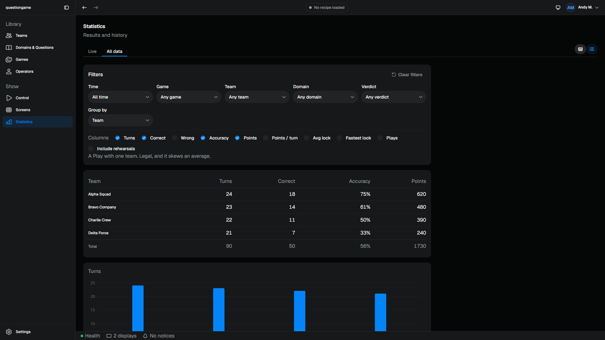 |
| **Screens** — restyle Stage and rewrite its words, on the real canvas. | **Statistics** — every turn of every Play, by team, domain or game. |

### Stage — what the teams, the audience and the camera see

| | |
| --- | --- |
| 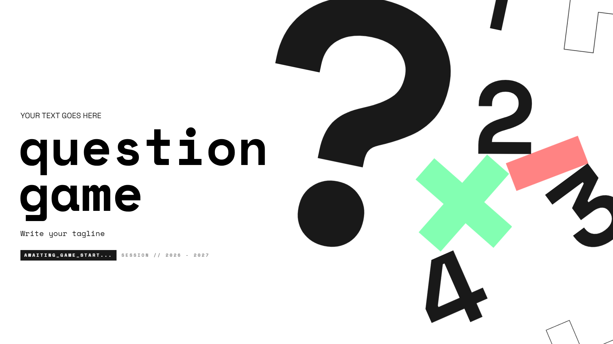 | 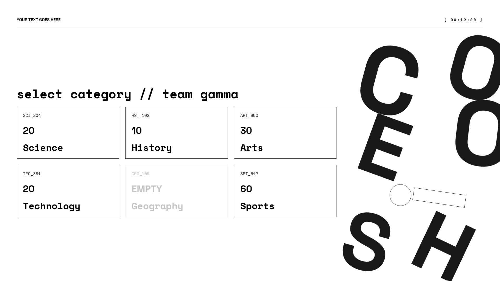 |
| **Idle** — the show's title while everyone gets ready. | **Choose domain** — the team picks a subject; difficulty rises by itself. |
| 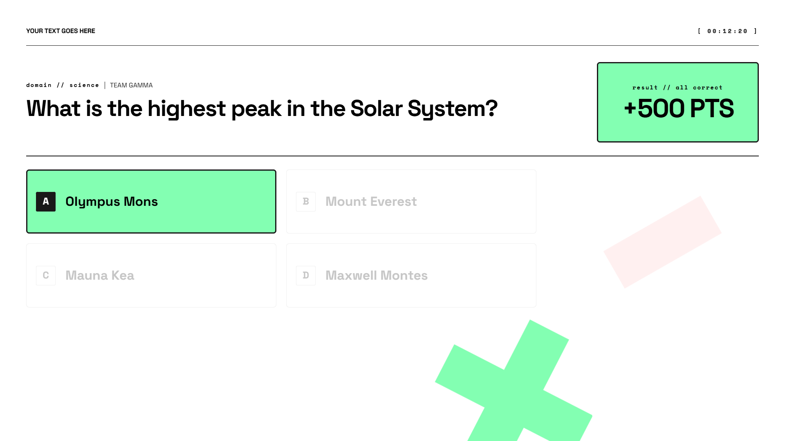 | 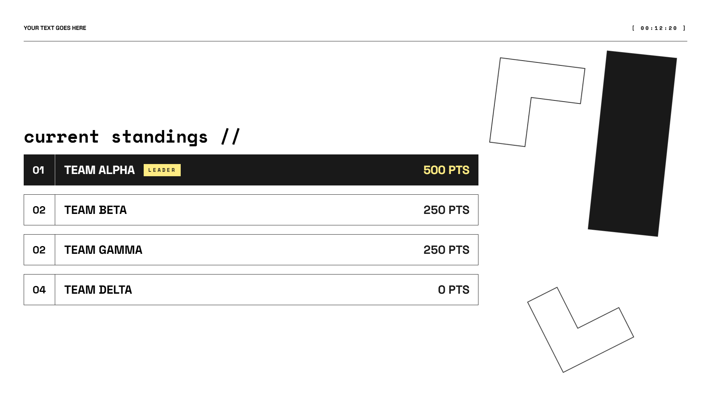 |
| **Question** — revealed step by step, then scored. | **Scoreboard** — the standings between turns. |

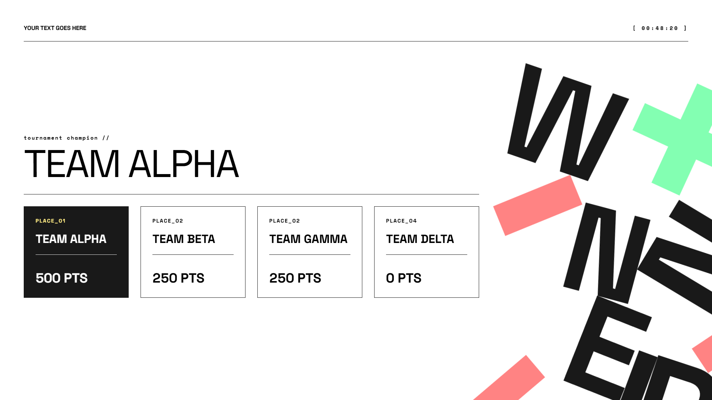
*The final leaderboard, revealed from last place to first.*

---

## For developers

Everything below is technical: building from source, testing, releasing, and
how the code is organised.

The app is a monorepo: a Rust host (Tauri 2) that owns every fact, and two
React webviews that only draw. See
[`docs/v1/04_ROADMAP.md`](docs/v1/04_ROADMAP.md) for what is built.

### Running it from source

```bash
npm install
npm run dev:app
```

That is the whole story: `tauri dev` starts both Vite dev servers itself
(`beforeDevCommand`), compiles the Rust host, and opens the Studio window. The
first Rust build takes a few minutes; after that it is seconds.

The Studio window opens on **Teams**. Build a library in the four tabs on the
left, then open a game and press **Load into Control**, which creates the Stage
window fullscreen on your primary display and takes you to **Control**:

1. **Start Play** in the Action Panel. The Game panel shows the ring and who
   holds the token.
2. Pick a domain on the **Viewer** (the real Stage, scaled) or press `1`–`9`.
3. Reveal the question and the answers, select, **Lock** (`Enter`), **Reveal
   outcome** (`R`). The timer cluster starts and pauses with `Space`.
4. **Strips** move Stage between screens and call any overlay by hand;
   **Timeline** undoes a turn (`Ctrl+Z`) without rewriting history.

The **Stage display** picker at the top sends Stage to another monitor; the
⚙ float holds the Global and Current-game settings.

One display is a valid setup: Stage goes fullscreen on it and Studio is an
Alt-Tab away. With an external display connected, **Stage display ▸ \<name\>**
sends Stage there and remembers it.

#### Working on Stage alone

```bash
npm run dev:stage      # http://localhost:5180/stage/
```

No Rust behind it, so Stage falls back to the P2/P3 **fixture strip**: every
screen and every state, switchable in place, no database. That fallback is
unreachable inside the app — if there is a host, the host wins.

```bash
npm run dev:studio     # http://localhost:5181/studio/?fake&play=question-issued
```

Studio alone says "No host" — unless the URL carries `?fake`, which installs an
in-memory host with a demo library (dev builds only); `&play=<fixture>` adds a
Play from a contract fixture so Control has something to draw. Every tab,
editor and dialog then works in a plain browser; only a Play cannot be
*started* (the fake is not an engine). That is
the Studio counterpart to Stage's fixture strip, and it is unreachable inside
the app: a real host always wins.

---

### Verifying

```bash
npm run test:all       # every TypeScript and Rust test
npm run typecheck      # tsc --build across all project references
npm run lint           # eslint — this is where the architecture rules live
npm run lint:host      # clippy over the host crate
npm run lint:app       # clippy over the Tauri crate
npm run map:check      # codemap.yaml matches the code (npm run map regenerates it)
npm run e2e            # the real app, driven through WebDriver (Windows; see below)
```

The end-to-end suite needs two tools once: `cargo install tauri-driver --locked`,
and `cargo install --git https://github.com/chippers/msedgedriver-tool` followed
by running `msedgedriver-tool` in `~/.cargo/bin`, which fetches the driver that
matches your WebView2. It runs its own build of the app (`org.questiongame.e2e`),
so it never touches your installed library or your dev library.

`npm run lint` is not cosmetic. `eslint.config.js` enforces the atomic-design
dependency direction, the rule that only organisms and pages may touch
`play-state` or the host, and the wall between the two design systems. A
violation is a failing lint, not a review comment.

```bash
npm run build          # licence audit + notices, then both webviews into dist/
npm run release:check  # dist/ loads nothing from the network, ships no dev code
npm run release        # typecheck, lint, every test, then the installer
```

`npm run release` writes the Windows installer to
`target/release/bundle/nsis/questiongame_<version>_x64-setup.exe`. The
installed app keeps its data in `%APPDATA%\org.questiongame.desktop`; a dev
build (`npm run dev:app`) keeps its own in `%APPDATA%\org.questiongame.app`,
so the two never touch each other's library and can run side by side.

`npm run build` fails if any shipped dependency is under a licence outside the
allowlist in `scripts/lib/notices.ts`. That is deliberate: a GPL program may
only ship what it can ship.

### Publishing a release

GitHub Actions builds both installers (`.github/workflows/release.yml`).

1. Bump the version in `Cargo.toml` (`[workspace.package]`),
   `crates/app/tauri.conf.json` and `package.json` — a test fails if they
   disagree — then commit.
2. Tag the commit with that version and push the tag:

   ```bash
   git tag v1.0.1
   git push origin v1.0.1
   ```

3. The workflow runs every test, builds the Windows installer and a universal
   macOS disk image, and publishes both on the
   [Releases](https://github.com/aAndy03/question-game/releases) page next to
   GitHub's source-code archives.

**Run workflow** on the Actions tab builds the same installers without
publishing; they are attached to the run.

---

### Layout

```
apps/
  stage/      the audience surface. Base UI + GSAP, questiongame tokens.
  studio/     the operator app. HeroUI v3 + Motion, HeroUI tokens.
              host/ (the command seam, queries, play-state, the fake host),
              chrome/ (nav, preferences, notices), copy/, then atoms →
              molecules → organisms → templates → pages.
packages/
  contract/   play-state, screens, node ids, reveal keys, command names.
              The only package both webviews and the Rust host share.
  design-stage/  questiongame tokens, fonts, decorative SVGs
  design-studio/ globals.css, the HeroUI theme scope
  text/       the Text module — one readable-string primitive, two impls
crates/
  host/       the four services. A plain library: a test sweeps its whole src
              tree for `tauri` and fails on a hit.
  app/        the Tauri 2 shell around it. Depends on the host; nothing
              depends on it.
dist/         where both webviews build. Tauri's frontendDist points here.
fixtures/     play-state JSON — the frontend's dev data and the host's
              integration assertions, the same files.
docs/v1/      the specs and the build plan
```

#### The one rule everything else follows

**Rust owns all truth. TypeScript owns only presentation.** A visual state
changes because the backend changed it, never because the frontend decided to.

```text
FlagService::freeze  →  CatalogService::build_snapshot  →  MatchService::play_load
                                                                    ↓
                                                    CatalogService::play_persist
```

- **`MatchService`** is the only writer of a Play. Undo appends an inverting
  event; the log never shrinks and is never edited.
- **`CatalogService`** is the only thing that runs SQL. `store.rs` is
  `pub(super)`; no interface hands a connection out.
- **`FlagService`** is the only flag reader, and stores nothing derived from a
  Play.
- **`PresentationService`** owns the screen and the overlay queue, and writes
  reveals *through* `MatchService` — there is no way to spell a second writer.
- **No clock inside the host.** Every command takes the millisecond it happened
  at, which is what makes a Play replayable and the tests deterministic. The
  only clock in the project is `crates/app/src/state.rs`.

---

### Two webviews, one origin

Both frontends are served under the path they occupy in the bundle —
`/studio/` and `/stage/` — in dev as well as in the installer. Studio's dev
server proxies `/stage` to Stage's.

That is not tidiness. Tauri's capability files scope permissions to
`URL: local`, and a webview pointed at an **external** URL is remote to the
ACL even when it is `localhost` — a remote webview is denied every command and
even `event.listen`. Sharing one origin keeps both windows local, keeps
`crates/app/capabilities/` tight, and means the app takes the same code path in
dev and in the bundle. There is no `is_dev()` branch anywhere.

**Stage may call exactly two commands** — `stage_ready` and
`overlay_ack_complete` — and both are it reporting on itself. Tauri does not
gate app-defined commands behind capabilities, so `crates/app/src/guard.rs`
refuses the rest by webview label. Stage is a projection, not a controller.

Set `RUST_LOG=questiongame_app=debug` to watch every invoke arrive with the
webview that sent it.

---

### Where to read next

| You want to know | Read |
| --- | --- |
| What the product *is*, and every locked rule | [`docs/v1/optimized_first_spec.md`](docs/v1/optimized_first_spec.md) |
| How the system is cut into modules, and why | [`docs/v1/01_codebase-design-spec-v1.md`](docs/v1/01_codebase-design-spec-v1.md) |
| What is built, what is next, and what each phase decided | [`docs/v1/04_ROADMAP.md`](docs/v1/04_ROADMAP.md) |
| What a word means before you name anything | [`docs/v1/03_CONTEXT.md`](docs/v1/03_CONTEXT.md) |
| How Stage is allowed to look | [`docs/questiongame Design System/readme.md`](docs/questiongame%20Design%20System/readme.md) |
| How Studio is allowed to look, and which component does what | [`docs/v1/05_STUDIO_DESIGN.md`](docs/v1/05_STUDIO_DESIGN.md) |
| The conventions an agent must not undo | [`CLAUDE.md`](CLAUDE.md) |

`optimized_first_spec.md` is the decision file. Where the code and that
document disagree, the document is right and the code is a bug.

---

---

## Contributors

questiongame was created by its two co-founders:

- **Darius** — co-founder
- **Andy** ([@aAndy03](https://github.com/aAndy03)) — co-founder and maintainer

Copyright (C) 2026 Darius and Andy (aAndy03). Licensed under the GNU General
Public License, version 3 or later ([`LICENSE`](LICENSE)).

Contributions are welcome. Read [`CLAUDE.md`](CLAUDE.md) and
[`docs/v1/03_CONTEXT.md`](docs/v1/03_CONTEXT.md) before opening a pull
request: the architecture rules are enforced by `npm run lint`.

---

## Licence

questiongame is free software under the **GNU General Public License,
version 3 or later** (GPL-3.0-or-later). See [`LICENSE`](LICENSE). You may use
it for anything, share it, and change it, as long as what you share stays
under the same licence. It comes with no warranty.

### GSAP

Stage animates with [GSAP](https://gsap.com), which is distributed under
GSAP's own *Standard "no charge" license*, not a free-software licence. So
that the GPL's freedoms still reach everyone who receives questiongame, its
licensors add this permission:

> **Additional permission under GNU GPL version 3 section 7.** If you modify
> this Program, or any covered work, by linking or combining it with GSAP (or
> a modified version of that library), containing parts covered by the terms
> of the GSAP Standard License, the licensors of this Program grant you
> additional permission to convey the resulting work.

Settings ▸ About in the app shows the licence, this permission, and the
licence of every library and font the build ships.
